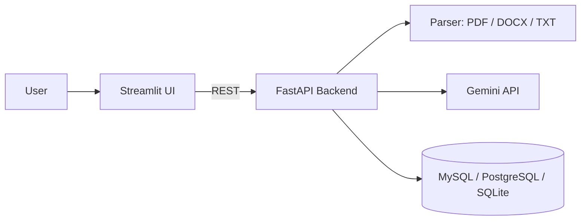

# AI Resume Analyzer


An AI-powered application that compares a resume with a job description and returns a match score,
section-level scores, skill-gap analysis and ATS-focused improvement suggestions. Every analysis is stored,
so candidates can track how their resume improves over time.

## Features

- Upload resumes as **PDF, DOCX or TXT**
- **Overall match score** plus breakdown for skills, experience, education and keywords
- **Matched vs. missing skills**, strengths, weaknesses and prioritised suggestions
- **ATS keyword recommendations** taken from the job description
- **Analysis history** stored in MySQL, PostgreSQL or SQLite, with view and delete
- **Downloadable reports** in Markdown and JSON
- Documented **REST API** (interactive Swagger UI at `/docs`)
- Prompt-injection-aware system prompt and strict output validation
- Dockerised, tested and CI-ready

## Architecture



## Tech Stack

| Layer | Technology |
|---|---|
| Frontend | Streamlit, Plotly |
| Backend | FastAPI, Pydantic v2, SQLAlchemy 2 |
| AI | Google Gemini (`google-genai`) |
| Database | MySQL 8 (Docker), PostgreSQL, SQLite (local default) |
| Parsing | pypdf, python-docx |
| DevOps | Docker, Docker Compose, GitHub Actions, Render |

## Quick Start (Docker)

```bash
git clone https://github.com/<your-username>/ai-resume-analyzer.git
cd ai-resume-analyzer
cp .env.example .env        # add your GEMINI_API_KEY
docker compose up --build
```

- UI: http://localhost:8501
- API docs: http://localhost:8000/docs

Get a free Gemini API key at https://aistudio.google.com/apikey.

## Local Development (without Docker)

```bash
# Terminal 1: backend (uses SQLite automatically)
cd backend
python -m venv venv && source venv/bin/activate      # Windows: venv\Scripts\activate
pip install -r requirements-dev.txt
export GEMINI_API_KEY=your_key                       # Windows: set GEMINI_API_KEY=your_key
uvicorn app.main:app --reload

# Terminal 2: frontend
cd frontend
python -m venv venv && source venv/bin/activate
pip install -r requirements.txt
streamlit run app.py
```

## API Reference

| Method | Endpoint | Description |
|---|---|---|
| `GET` | `/health` | Service status |
| `POST` | `/api/analyze` | Analyze a resume (multipart: `resume`, `job_description`, `job_title`) |
| `GET` | `/api/history` | List previous analyses |
| `GET` | `/api/history/{id}` | Get a full analysis |
| `DELETE` | `/api/history/{id}` | Delete an analysis |

```bash
curl -X POST http://localhost:8000/api/analyze \
  -F "resume=@resume.pdf" \
  -F "job_title=AI Engineer" \
  -F "job_description=$(cat job_description.txt)"
```

## Configuration

| Variable | Default | Description |
|---|---|---|
| `GEMINI_API_KEY` | required | Google Gemini API key |
| `GEMINI_MODEL` | `gemini-2.5-flash` | Model used for analysis |
| `DATABASE_URL` | `sqlite:///./data/app.db` | SQLAlchemy URL (MySQL, PostgreSQL or SQLite) |
| `MAX_UPLOAD_MB` | `5` | Maximum resume size |
| `CORS_ORIGINS` | `*` | Comma-separated allowed origins |
| `API_URL` | `http://localhost:8000` | Backend URL used by the frontend |

## Deployment

**Docker Compose on a VPS (AWS EC2, DigitalOcean, etc.)**
Install Docker, clone the repository, create `.env`, run `docker compose up -d --build`, then place Nginx or
Caddy in front of ports 8501 and 8000 for HTTPS.

**Render (free tier available)**
1. Push the repository to GitHub.
2. In Render, choose *New > Blueprint* and select the repository (`render.yaml` is included).
3. Set `GEMINI_API_KEY` on the API service. For persistent history, also set `DATABASE_URL` to a managed
   MySQL or PostgreSQL instance; without it SQLite is used and data is lost on redeploy.
4. Copy the API's public URL into the UI service as `API_URL`.

## Testing

```bash
cd backend
pytest -q
```

The suite mocks the LLM, so it runs offline and needs no API key.

## Project Structure

```
ai-resume-analyzer/
├── backend/
│   ├── app/
│   │   ├── main.py            # FastAPI app, CORS, health check
│   │   ├── config.py          # Environment-based settings
│   │   ├── database.py        # Engine, sessions, init with retry
│   │   ├── models.py          # ORM models
│   │   ├── schemas.py         # Pydantic schemas with score validation
│   │   ├── routers/analysis.py
│   │   └── services/
│   │       ├── parser.py      # PDF / DOCX / TXT extraction
│   │       └── llm.py         # Gemini integration and prompt
│   ├── tests/
│   ├── Dockerfile
│   └── requirements.txt
├── frontend/
│   ├── app.py                 # Streamlit UI
│   ├── api_client.py          # Backend client
│   ├── .streamlit/config.toml
│   └── Dockerfile
├── render.yaml
├── .env.example
└── README.md
```

## Roadmap

- User accounts and authentication
- Side-by-side comparison of multiple resumes
- Cover letter generation
- Langfuse tracing for LLM observability

## License

MIT
